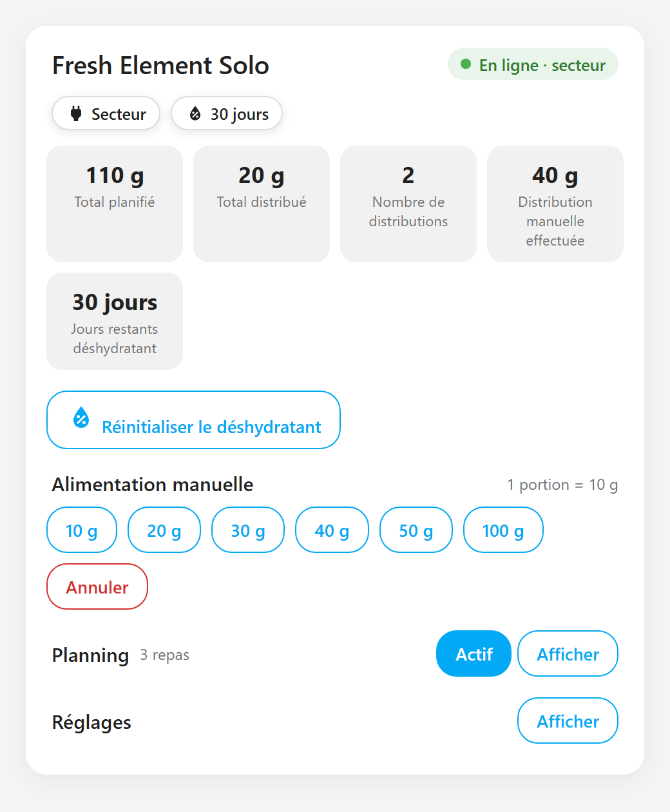

# 🐶 Petkit Fresh Element Card

[](https://github.com/hacs/integration)
[](https://github.com/Rimfire03/Petkit-Fresh-Element-Card/releases)
[](https://opensource.org/licenses/MIT)
[](https://buymeacoffee.com/slide598b)

> A modern, elegant Lovelace card for the **PetKit Fresh Element** automatic feeders in **Home Assistant**, ready for **HACS**. Pick your feeder, everything else is detected.  
> *Une carte Lovelace moderne et épurée pour les distributeurs automatiques **PetKit Fresh Element** sous **Home Assistant**, prête pour **HACS**. Choisissez votre distributeur, le reste est détecté.*

---

## ☕ Support / Soutenir le projet

If you find this card helpful, consider buying me a coffee to support the development!  
*Si vous appréciez cette carte, vous pouvez m'offrir un café pour soutenir le développement !*

<a href="https://buymeacoffee.com/slide598b" target="_blank"></a>

---

## 🌐 Languages Supported / Langues Disponibles

- 🇬🇧 **English** (Default fallback)
- 🇫🇷 **Français**
- 🇩🇪 **Deutsch**
- 🇪🇸 **Español**
- 🇮🇹 **Italiano**
- 🇳🇱 **Nederlands**
- 🇵🇹 **Português**

*The card uses the translations of Home Assistant first (entity names, units, weekdays, common buttons), then its own small dictionary. It follows your Home Assistant language, or `language: en | fr | de | es | it | nl | pt` in the card configuration.*

---

<p align="center">
  
  &nbsp;&nbsp;
  
</p>
<p align="center"><em>Standard / Compact (<code>show_image: false</code>)</em></p>

---

# 🇬🇧 English Documentation

## ✨ Features

- **Status at a glance**: badge with the device state (online on mains or battery, offline, feeding, food low, error), power or battery chip, desiccant days left, daily totals (planned, dispensed, number of feedings, manual).
- **Manual feeding**: quick buttons built from the amounts the feeder accepts (read from the Home Assistant entity). On the single-hopper models, **100 g** is sent as 2 × 50 g, the second one starting when the first one is finished. One row per hopper on the dual-hopper models. A **Cancel** button stops a running feed.
- **Editable schedule** (folded by default): add, edit, delete a meal, skip or restore it for today, switch the whole plan on or off. Amounts are shown in grams or portions depending on the model, one slider per hopper on the dual-hopper models, and the weekdays are per meal or for the whole plan depending on the model.
- **Settings**: meal sound, indicator light, child lock, shortage alarm and the notifications, with the names translated by Home Assistant.
- **Desiccant**: reset button always visible.
- **Compact mode**: hide the picture with `show_image: false`.
- **Just pick the device**: the entities are found through the Home Assistant entity registry, in any language. The model is detected from the device, and can be forced.
- **Visual editor**: device, model, title, picture, language.

## 🧰 Supported equipment

This card was made to be compatible with the [PetKit integration](https://github.com/Jezza34000/homeassistant_petkit) (`petkit`) by Jezza34000, which must be installed. It works with the feeders of that integration. The behaviour of each model is read from the feeding schedule entity, so a model the integration adds later works without a card update.

| Model | Type | Hoppers | Schedule weekdays | Amounts | Manual feed |
|---|---|---|---|---|---|
| Fresh Element Solo | `d4` | 1 | per meal | portions | 10 – 50 g (+ 100 g) |
| Fresh Element Solo (D4H) | `d4h` | 1 | per meal | portions | 10 – 50 g (+ 100 g) |
| Yumshare Solo 2 | `d4h` | 1 | per meal | portions | 10 – 50 g (+ 100 g) |
| Fresh Element 3 | `d3` | 1 | per meal | grams (5 – 200) | 5 – 200 g |
| Fresh Element | `feeder` (D1) | 1 | whole plan | portions | 20 – 400 g |
| Fresh Element Mini | `feedermini` | 1 | whole plan | portions | 5 – 50 g |
| Fresh Element dual hopper | `d4s` | 2 | per meal | portions per hopper | 1 – 10 per hopper |
| Fresh Element dual hopper | `d4sh` | 2 | per meal | portions per hopper | 1 – 10 per hopper |

> The Yumshare Solo 2 uses a placeholder by default. The D1 uses the Solo picture. Use `image` to supply a picture or replace a built-in one. Only the Solo has been tested on a real device, the other models follow the integration data and are not tested.

---

## 📦 Installation

### Method 1: Via HACS (Recommended)

1. Open **HACS** and search **Petkit Fresh Element Card** (the card is in the HACS default store).
2. Download it, then reload your browser.

*Not listed yet? Open **HACS** > three dots > **Custom repositories**, add `https://github.com/Rimfire03/Petkit-Fresh-Element-Card` with the category **Dashboard**.*

### Method 2: Manual Installation

1. Download `petkit-fresh-element-card.js` from the [latest release](https://github.com/Rimfire03/Petkit-Fresh-Element-Card/releases).
2. Copy it to `/config/www/`.
3. Add the resource `/local/petkit-fresh-element-card.js` (type **JavaScript Module**) in **Settings > Dashboards > Resources**.

---

## 🛠️ Configuration Example (YAML)

```yaml
type: custom:petkit-fresh-element-card
device: e8f4df6a0bf836628288df28196dd3c7   # the only required option: your Petkit feeder
# model: solo                              # optional, detected from the device
# title: Fresh Element Solo                # optional
# show_image: false                        # optional, compact card
# image: /local/feeder.png                 # optional
# language: en                             # optional: en | fr | de | es | it | nl | pt
```

Use the visual editor to pick the device, no need to write its id.

## ⚙️ Configuration Reference

| Option | Type | Default | Description |
|---|---|---|---|
| `device` | Device id | **required** | The Petkit feeder to display |
| `model` | `solo`, `d4h`, `d3`, `d1`, `mini`, `d4s`, `d4sh`, `yumshare_solo_2` | auto | Forces the model (name and picture). The behaviour always follows the device capabilities |
| `title` | string | device name | Card title |
| `show_image` | boolean | `true` | `false` hides the picture: compact card |
| `image` | string | model picture | URL or `/local/...` of your own picture |
| `language` | `en`, `fr`, `de`, `es`, `it`, `nl`, `pt` | Home Assistant language | Forces the language |
| `entities` | map | auto | Forces an entity, for example `entities: { battery: sensor.my_battery }` |

The keys of `entities` are: `schedule`, `manual`, `manual_h1`, `manual_h2`, `cancel_manual`, `reset_desiccant`, `state`, `error`, `food_low`, `food_low_h1`, `food_low_h2`, `feeding`, `battery`, `power_type`, `desiccant_days`, `planned_total`, `dispensed_total`, `dispense_count`, `manual_total`, `sw_meal_sound`, `sw_light`, `sw_child_lock`, `sw_shortage`, `sw_n_dispense`, `sw_n_battery`, `sw_n_desiccant`, `sw_n_refill`.

The schedule uses the services `petkit.add_feeding_schedule_entry`, `edit_feeding_schedule_entry`, `remove_feeding_schedule_entry`, `skip_scheduled_feed`, `restore_scheduled_feed` and `set_feeding_plan_weekdays`.

---

# 🇫🇷 Documentation en Français

## ✨ Fonctionnalités

- **État en un coup d'œil** : badge d'état (en ligne secteur ou batterie, hors ligne, distribution, réservoir bas, erreur), pastille secteur ou batterie, jours de déshydratant restants, totaux du jour (planifié, distribué, nombre de distributions, manuel).
- **Distribution manuelle** : boutons rapides construits à partir des quantités acceptées par le distributeur (lues dans l'entité Home Assistant). Sur les modèles à un réservoir, **100 g** est envoyé en 2 × 50 g, la seconde partant quand la première est terminée. Une ligne par réservoir sur les modèles à deux réservoirs. Un bouton **Annuler** arrête une distribution en cours.
- **Planning éditable** (replié par défaut) : ajouter, modifier, supprimer un repas, l'ignorer ou le rétablir pour aujourd'hui, activer ou couper tout le planning. Les quantités sont en grammes ou en portions selon le modèle, un curseur par réservoir sur les modèles à deux réservoirs, et les jours sont par repas ou pour tout le planning selon le modèle.
- **Réglages** : son du repas, voyant lumineux, sécurité enfant, alarme de pénurie et notifications, avec les noms traduits par Home Assistant.
- **Déshydratant** : bouton de réinitialisation toujours visible.
- **Mode compact** : masquez l'image avec `show_image: false`.
- **Choisissez simplement l'appareil** : les entités sont retrouvées par le registre d'entités de Home Assistant, quelle que soit la langue. Le modèle est détecté depuis l'appareil, et peut être forcé.
- **Éditeur visuel** : appareil, modèle, titre, image, langue.

## 🧰 Équipements pris en charge

Cette carte a été réalisée pour être compatible avec l'[intégration PetKit](https://github.com/Jezza34000/homeassistant_petkit) (`petkit`) de Jezza34000, qui doit être installée. Elle fonctionne avec les distributeurs de cette intégration. Le comportement de chaque modèle est lu dans l'entité de planning, un modèle ajouté plus tard par l'intégration fonctionne donc sans mise à jour de la carte.

| Modèle | Type | Réservoirs | Jours du planning | Quantités | Distribution manuelle |
|---|---|---|---|---|---|
| Fresh Element Solo | `d4` | 1 | par repas | portions | 10 – 50 g (+ 100 g) |
| Fresh Element Solo (D4H) | `d4h` | 1 | par repas | portions | 10 – 50 g (+ 100 g) |
| Yumshare Solo 2 | `d4h` | 1 | par repas | portions | 10 – 50 g (+ 100 g) |
| Fresh Element 3 | `d3` | 1 | par repas | grammes (5 – 200) | 5 – 200 g |
| Fresh Element | `feeder` (D1) | 1 | tout le planning | portions | 20 – 400 g |
| Fresh Element Mini | `feedermini` | 1 | tout le planning | portions | 5 – 50 g |
| Fresh Element double réservoir | `d4s` | 2 | par repas | portions par réservoir | 1 – 10 par réservoir |
| Fresh Element double réservoir | `d4sh` | 2 | par repas | portions par réservoir | 1 – 10 par réservoir |

> Le Yumshare Solo 2 affiche une icône par défaut. Le D1 utilise l'image du Solo. Utilisez `image` pour ajouter une photo ou remplacer une image intégrée. Seul le Solo a été testé sur un vrai appareil, les autres modèles suivent les données de l'intégration et ne sont pas testés.

---

## 📦 Installation

### Méthode 1 : Via HACS (Recommandé)

1. Ouvrez **HACS** et cherchez **Petkit Fresh Element Card** (la carte est dans le magasin par défaut de HACS).
2. Téléchargez-la, puis rechargez votre navigateur.

*Pas encore listée ? Ouvrez **HACS** > trois points > **Dépôts personnalisés**, ajoutez `https://github.com/Rimfire03/Petkit-Fresh-Element-Card` avec la catégorie **Tableau de bord**.*

### Méthode 2 : Installation manuelle

1. Téléchargez `petkit-fresh-element-card.js` depuis la [dernière release](https://github.com/Rimfire03/Petkit-Fresh-Element-Card/releases).
2. Copiez-le dans `/config/www/`.
3. Ajoutez la ressource `/local/petkit-fresh-element-card.js` (type **Module JavaScript**) dans **Paramètres > Tableaux de bord > Ressources**.

---

## 🛠️ Exemple de Configuration YAML

```yaml
type: custom:petkit-fresh-element-card
device: e8f4df6a0bf836628288df28196dd3c7   # seule option requise : votre distributeur Petkit
# model: solo                              # optionnel, détecté depuis l'appareil
# title: Fresh Element Solo                # optionnel
# show_image: false                        # optionnel, carte compacte
# image: /local/distributeur.png           # optionnel
# language: fr                             # optionnel : en | fr | de | es | it | nl | pt
```

Utilisez l'éditeur visuel pour choisir l'appareil, inutile de saisir son identifiant.

---

## 📄 Licence

MIT, voir [LICENSE](LICENSE).
