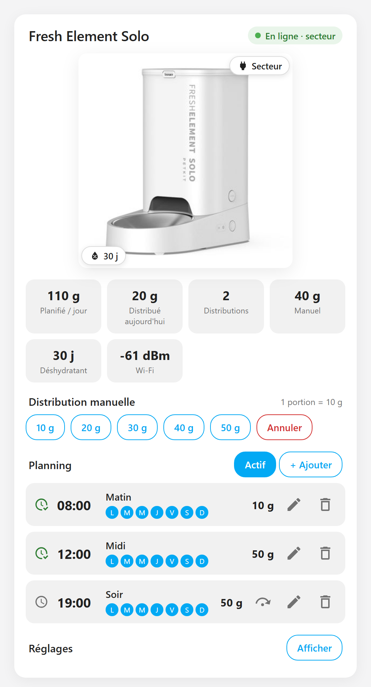

# Petkit Fresh Element Card

Carte Lovelace pour le distributeur PetKit Fresh Element Solo (intégration HA `petkit`) : état, distribution manuelle, planning éditable (ajout / modification / suppression / ignorer aujourd'hui), réglages.

<p align="center"></p>

## Installation

Copier `petkit-fresh-element-card.js` dans `/config/www/`, puis ajouter la ressource `/local/petkit-fresh-element-card.js` (type module).

## Configuration

```yaml
type: custom:petkit-fresh-element-card
schedule: switch.cellier_fresh_element_solo_feeding_schedule   # seule option requise
title: Fresh Element Solo                                      # optionnel
image: /local/solo.png                                         # optionnel (défaut : image zooplus)
```

Les autres entités sont déduites du préfixe du switch (`cellier_fresh_element_solo`). Chacune peut être forcée par sa clé : `manual`, `cancel_manual`, `reset_desiccant`, `state`, `error`, `food_low`, `feeding`, `battery`, `power_type`, `desiccant_days`, `planned_total`, `dispensed_total`, `dispense_count`, `manual_total`, `sw_meal_sound`, `sw_light`, `sw_child_lock`, `sw_shortage`, `sw_n_dispense`, `sw_n_battery`, `sw_n_desiccant`, `sw_n_refill`.

Le planning utilise les services `petkit.add/edit/remove_feeding_schedule_entry`, `skip_scheduled_feed` et `restore_scheduled_feed` (1 portion = 10 g).
